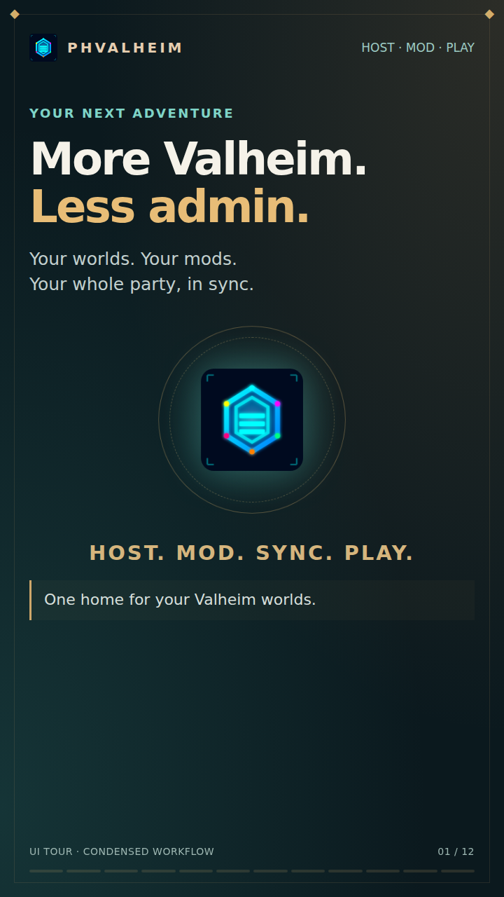

  

<h1 align="center">Your worlds. Your friends. Your mods.</h1>

  PhValheim hosts your Valheim worlds and keeps your group's mods in sync. 
  Manage everything in your browser. Spend more time playing.

  <a href="https://brianmiller.github.io/phvalheim-server/"><strong>Read the guides</strong></a> ·
  <a href="https://github.com/brianmiller/phvalheim-server/releases/latest">Latest release</a> ·
  <a href="https://discord.gg/8RMMrJVQgy">Join Discord</a>

## Where would you like to start?

| I'm hosting | I'm playing | I have a mod idea |
| --- | --- | --- |
| Bring up a server and create your first world. | Install the client, sync and join your friends. | Let Hugin help you write, build and package it. |
| **[Set up a server →](https://brianmiller.github.io/phvalheim-server/start/install/)** | **[Join a world →](https://brianmiller.github.io/phvalheim-server/play/join/)** | **[Make your first Vibe →](https://brianmiller.github.io/phvalheim-server/vibes/first-mod/)** |

   
  <strong><a href="https://brianmiller.github.io/phvalheim-server/start/tour/">▶ PhValheim in one minute — Host. Mod. Sync. Play.</a></strong>

## Less setup between you and the next adventure

- **Vanilla and modded worlds together.** Run several worlds from one Docker container.
- **The same mods for the whole party.** Choose from Thunderstore, Hexium and your own local catalogue. Players sync through the PhValheim client before launching.
- **A home for the day-to-day work.** Access lists, backups, restores, updates, configurations and logs in one admin UI.
- **A raven with useful skills.** Ask Hugin to investigate server problems and propose changes, or use his Vibes workshop to create mods. Hosted and self-hosted AI providers are optional.

## Meet Hugin's Vibes

> “Make a small stamina tweak with a setting I can change later.”

Start with an idea. Hugin writes C#, runs the compiler and works through build feedback with you. The optional **Build Pak** prepares the tools and references, using game libraries from your own installed world.

Each Vibe has its own **local Git repository**. Package the plugin and publish it to your **Hugin's Vibes catalogue**, then select it on a test world, update, sync and play. Import from GitHub or GitLab when you want to bring an existing project along.

## Ready to host?

Use **[Docker Compose](https://brianmiller.github.io/phvalheim-server/start/install/)**, **[Unraid or Kubernetes](https://brianmiller.github.io/phvalheim-server/start/other-platforms/)**. The setup wizard handles the settings after the container starts.

Image: `theoriginalbrian/phvalheim-server:latest`

Keep `/opt/stateful` persistent and the admin UI private. The install guide includes a ready-to-copy Compose file, storage paths, ports and first-run steps.

## Already running a server?

[Update PhValheim](https://brianmiller.github.io/phvalheim-server/host/updating/) · [Manage mods](https://brianmiller.github.io/phvalheim-server/host/mods/) · [Back up a world](https://brianmiller.github.io/phvalheim-server/host/backups/) · [Troubleshoot](https://brianmiller.github.io/phvalheim-server/host/troubleshooting/)

**Need help?** [Ask on Discord](https://discord.gg/8RMMrJVQgy) or [report an issue](https://github.com/brianmiller/phvalheim-server/issues).

[PhValheim Client](https://github.com/brianmiller/phvalheim-client) · [Companion](https://github.com/brianmiller/phvalheim-companion) · [Changelog](CHANGELOG.md) · [Contribute to the docs](website/README.md)
