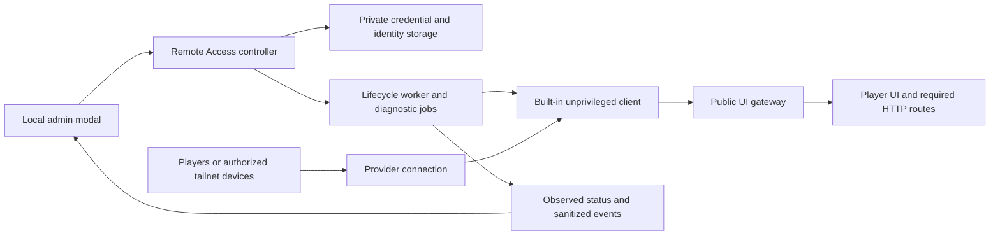

# Remote Access: architecture and operator experience

**Status: development implementation; stable release inclusion remains subject to
validation.** [Issue #114](https://github.com/brianmiller/phvalheim-server/issues/114)
owns implementation tasks, ownership, acceptance criteria, and current status.

## Development implementation

The implementation runs both clients inside the existing PhValheim container.
The earlier sidecar design was rejected because it made installation too complex.
Supervisor starts a small idle controller; provider processes run only after an
operator requests connection/enrollment. No additional container, mount, TUN
device, or Docker capability is required. Credentials persist in a private
`/opt/stateful/remote-access` directory on the existing data volume. The public
website gateway listens only on `127.0.0.1:18080` to avoid the existing 8080 listener.

The modal has Website and Game connections tabs. Website starts with three
method cards, followed by compact setup steps and connection status. Copy buttons,
live diagnostic rows, and expandable details provide evidence without crowding setup. Cloudflare and private
Tailscale Serve are implemented; Funnel and managed provisioning remain deferred.
A connector observation is distinct from a server-originated URL check and a
browser/device challenge. The initial transfer check uses a small diagnostic
response; it does not certify archive delivery. Tailscale requires a second
authorized device to test its private route. No external verifier service is used.

Connectors start off, persist their selected provider and credentials privately,
and support disconnect/forget. Viewing another method shows a link back to the
active connection, never its URL or actions under the other provider. Tailscale
Serve approval output survives command timeouts and appears as an account approval
action; retries back off and recover automatically after approval.
Changing provider replaces the selected URL;
re-enter the former URL when switching back. The existing public website already
derives its URL from the request Host; the fixed gateway sets that hostname and
HTTPS forwarding metadata without changing stored game connection settings.

See [the operator guide](../website/docs/host/remote-access.md) and
[Compose example](../deploy/remote-access.compose.yml) for the tested installation.
The remaining sections record the design intent; issue #114 records validation
and any remaining acceptance work rather than claiming every release gate passed.

## Product scope

Let an operator connect the player portal using an account they already control.
PhValheim manages the connector, explains setup, and reports observed results.
The operator should not need a terminal for the normal setup flow.

| Connection | Audience | Setup | Initial scope |
| --- | --- | --- | --- |
| Cloudflare Tunnel | Public internet, with existing PhValheim player authentication | Operator's tunnel token and HTTPS hostname | First provider |
| Tailscale Serve | Devices/users permitted by the operator's tailnet policy | Browser sign-in, then enable private HTTPS access | Second provider |
| Tailscale Funnel | Public internet on a Tailscale hostname | Separate explicit public-access setup | Deferred |
| PhValheim-managed | Public internet on a PhValheim-provided hostname | Future enrollment service | Deferred |

Remote Access is **off by default**, including upgrades. Initially permit one active
provider per instance; switching requires an explicit disconnect and preserves the
saved credentials for recovery. A failed new connection never silently restarts
the old public route.

This feature connects the **player web UI and its required HTTP endpoints**. It does
not expose the admin UI, configure game UDP ports, or provide a game VPN. Show this
plainly: “Website tunnels do not forward Valheim’s UDP traffic.” The Game
connections view explains existing settings and manual firewall setup.
DDNS, a central provisioning service, custom proxy targets, subnet routing, exit
nodes, and Tailscale SSH are outside the initial scope.

## Operator entry point

Add **Remote Access** to the admin navigation and link it from Server Settings.
Use the existing admin `mods-modal-overlay` dialog pattern, not the public site's
Bootstrap modal components. Include a globe icon in navigation. The Website tab
starts with Direct connection, Cloudflare, and Tailscale cards and an audience
label. A configured provider opens its status view, with only currently relevant
actions visible. The Game connections tab provides per-world direct UDP and
crossplay guidance.

Keep the hostname, audience, current condition, last check time, and next action
visible. Put connection identifiers, technical observations, and sanitized recent
events behind **Connection details**. Do not make operators read logs to find the
next setup step. Example summary, with illustrative results only:

```text
Remote Access                                      [Close]
Cloudflare Tunnel                         Public website
https://play.example.net                   [Copy] [Open]

Connected — URL verified from this server
Last checked 4 seconds ago
Outside-network check: not yet verified

[Test connection] [Configure] [Disconnect]
Connection details >
```

The production UI must never display these sample values as real observations.
An enabled switch means the operator requested a connection, not that it succeeded.

## Cloudflare setup modal

Title: **Connect with Cloudflare**. Intro: “Use your own domain to share your player
website. You'll need a Cloudflare account and a domain managed there.” Provide
**Open Cloudflare** and **Setup guide** links beside the instructions.

1. **Create a tunnel.** In Cloudflare, open **Networking → Tunnels**, create a
   tunnel, and give it a recognizable name. Copy its connector token. Explain:
   “PhValheim runs the connector for you. Paste only the token; you don't need to
   run Cloudflare's installation command here.”
2. **Add your website route.** Add a published application route with the desired
   hostname. Choose HTTP and paste the **Origin address** shown by PhValheim.
   Include a **Copy** button. The generated address is `http://127.0.0.1:18080` inside the existing
   PhValheim container. It requires no published port.
3. **Connect and test.** Paste the token and the full HTTPS website URL into
   labeled fields. Show “This makes your player website publicly reachable” above
   **Connect and test**. Keep the live test results in this same modal.

These instructions follow Cloudflare's [tunnel setup guide](https://developers.cloudflare.com/tunnel/get-started/).
Maintain dashboard labels against supported provider versions before release.

Fields are **Tunnel token** (masked, paste-friendly) and **Website URL**. A saved
token appears as “Token saved” with **Replace token**, never a reusable secret
returned to the browser. Reject pasted installation commands with a helpful
message; never evaluate them. Accept a normalized HTTPS hostname on port 443 with
no user information, query, fragment, or custom path. Show the normalized value
before applying it. Do not request a Cloudflare account API key.

**Save without connecting** stores configuration while leaving access off.
**Connect and test** validates inputs, saves, starts the connector, and launches
diagnostics. Explain that connectivity can begin before testing completes. A
failed test leaves the operator's requested connection active with an error and a
visible **Disconnect** button; it does not label the site ready or silently undo
the request. Invalid or unsafe configuration never starts a connector.

## Tailscale setup modal

Title: **Connect privately with Tailscale**. Intro: “Only devices allowed by your
Tailscale network can reach this website. Players need Tailscale on their devices.”

1. **Sign in.** Select **Sign in to Tailscale**. Start this instance's enrollment
   and open the provider-issued login link in a new tab, with a copy-link fallback.
   Show “Waiting for sign-in” and the actual expiry if available. Detect successful
   enrollment automatically; do not ask the operator to claim it succeeded. Validate
   the login link's HTTPS scheme and supported provider host before presenting it;
   keep enrollment links out of ordinary logs and diagnostic exports.
2. **Allow private HTTPS access.** Show the discovered device name and tailnet
   hostname. If device approval, MagicDNS, HTTPS certificates, or policy changes
   are required, show a specific **Open Tailscale settings** action and the missing
   prerequisite. Explain that a tailnet administrator may need to approve it.
3. **Connect and test.** Enable Serve for the player UI. Display the discovered
   HTTPS URL with **Copy** and **Open**. Guide the operator to open a test link on
   a second device signed into an authorized Tailscale account.

Serve provides private HTTPS access; its setup prerequisites are described in the
[Tailscale Serve documentation](https://tailscale.com/docs/features/tailscale-serve).

Place **Use an auth key instead** in an optional advanced section. Explain where to
create an enrollment key, recommend a single-use key for this device, and remove
the bootstrap secret after successful enrollment. Persist the device identity
separately. An expired enrollment key is different from an expired device identity;
show the appropriate recovery action. See [auth keys](https://tailscale.com/docs/features/access-control/auth-keys).

Enrollment and website exposure are separate states. Signing in creates a device;
**Connect and test** enables the private website. Do not enable Funnel, accept
subnet routes, advertise routes, enable SSH, or make this an exit node during setup.
Do not offer a casual public/private switch: Funnel changes the audience and has
different constraints, including bandwidth limits and Tailscale hostnames.
[Funnel documentation](https://tailscale.com/docs/features/tailscale-funnel)

## Live testing and honest status

Use a backend diagnostic job, not simulated progress. Each row has a measured state:
**Waiting**, **Checking**, **Passed**, **Failed**, **Blocked**, **Not tested**, or
**Stale**, with a timestamp and actionable explanation. Show elapsed time rather
than a fabricated percentage. An unavailable observation is unknown, not healthy.

| Check | Evidence required | What it cannot prove |
| --- | --- | --- |
| Configuration | Valid supported fields and stored credentials | Credential accepted by provider |
| Connector | Current supervised process state and version | Provider connection or website availability |
| Provider connection | Current connector metrics/status; authenticated Tailscale state | Correct origin route or another user's access |
| Local player UI | Response from the fixed public listener | Remote reachability |
| Name resolution | Observed answers for the configured hostname from the stated resolver | Every resolver worldwide has updated |
| HTTPS | Hostname-valid certificate, trusted chain, observed expiry | Correct PhValheim instance behind the URL |
| Website route | Fresh instance-bound challenge response through that hostname | Steam login, full downloads, or access from every network |
| Download path | Bounded diagnostic transfer through the same permitted download path | A full mod pack will finish successfully |
| Other device | Fresh challenge received from the operator's test browser/device | Its location, all tailnet identities, or game UDP access |

Cloudflare explicitly separates tunnel health from origin reachability in its
[observability documentation](https://developers.cloudflare.com/tunnel/observability/).
Use structured local observations where available. Do not require an account
management credential just to populate a status panel, or parse success from one
old log message.

The overall display combines **requested state**, **connector state**, and
**verification state**. Examples: “Off,” “Waiting for sign-in,” “Connecting,”
“Connected — website check failed,” “Connected — URL verified from this server,”
“Reconnecting,” and “Status unavailable.” Keep last successful observations visible
with their age after failure; never keep a stale green status as current health.

Poll the authenticated admin status endpoint every two seconds while connecting or
testing and every five seconds while the open modal is idle. Avoid overlapping
requests; pause polling when hidden and fetch immediately on return. Mark live
observations stale after 15 seconds without refresh. A URL test records its own
time, source, and configuration revision, becomes stale after five minutes, and is
invalidated immediately by configuration changes or loss of connection. Provider
checks can run cheaply in the background; opening a modal must not trigger a large
download. Use a short, jittered backoff for automatic reconnection.

**Test connection** starts a bounded job and streams its observed step changes
through polling. Default limits: five-second connect timeout, 15 seconds per
network request, 60 seconds per test run, one active run per configuration, and a
10-second manual retry cooldown. Provider enrollment has a separate waiting state
and expiry. Include **Retry failed checks**, not an endless spinner.

Closing a modal stops its polling but does not disconnect or cancel an accepted
backend job. Reopening shows the same operation. **Cancel test** cancels diagnostics
only; **Disconnect** stops access. Warn before discarding unsaved form edits.
Serialize configuration changes and disconnects; late results from an earlier
configuration must never overwrite current status.

## Verifying the correct route

Create a random, short-lived diagnostic challenge bound to this installation,
configuration revision, and test run. Serve it only while that test is active,
through a narrowly defined public diagnostic endpoint, with `Cache-Control:
no-store`. Do not expose configuration, logs, stable identifiers, or credentials.
Require the exact fresh response: a generic HTTP 200, Cloudflare login page, cached
page, or another PhValheim installation must fail route verification.

Test the external hostname from the instance first, labeling that vantage point
explicitly. Offer **Test from another device** with a copyable short-lived test
link. A successful browser callback proves that browser reached the route; it does
not prove the browser was outside the LAN. Ask the operator to try a phone on mobile
data for public access, or another authorized Tailscale device for private access.
Separate a reported manual result from a recorded challenge response. A user
clicking “I tested it” is not an automated pass.

No hosted external probe service is required for the initial feature. Consequently,
the UI must not claim independent external verification when none was performed.
Self-tests on a Tailscale node cannot establish another user's policy permissions.
If an external probe service is added later, its location and result source must be
recorded, and operators must explicitly opt into sending it the hostname.

The download probe uses a tiny, temporary diagnostic artifact with a known digest,
strict size limits, and the same relevant routing as client payloads. It must not
broaden the existing world archive allowlist or download a user's full mod pack
automatically. Keep successful real client launch, config/full archive download,
and Steam sign-in as separate end-to-end validation evidence.

## Architecture and security boundaries



The controller exposes a small admin-only contract: read configuration without
secrets, save, enroll, connect, disconnect, replace credentials, forget, start/cancel
a test, and read status. Mutations use POST, session-bound CSRF protection, strict
Origin/Host matching, and the existing private admin access boundary. Setup must
work from the operator's ordinary admin URL, including LAN HTTP IP addresses and
hostnames and existing HTTPS reverse proxies. It must not require SSH, localhost,
a terminal, or another container. Keep the provider steps in the modal; transport
failures report the failed request without inventing setup prerequisites.

The admin UI is a trusted-network interface, not an authenticated internet
service. HTTP does not encrypt entered credentials; existing HTTPS access is
supported. Remote Access does not make admin public or change its network boundary.
Strict same-origin checks and CSRF protect against cross-origin requests, but are
not a complete DNS-rebinding defense for the existing admin application. Deployment
network controls and any existing reverse-proxy Host allowlist remain applicable.
Do not claim that a future player tunnel encrypts the current admin session.

PHP handles validated requests; a worker performs slow provider operations. Use
typed fixed arguments, never shell interpolation of token/hostname input. Reuse
Supervisor lifecycle management and the existing event/operation conventions where
appropriate. Jobs have IDs, configuration revisions, step evidence, timestamps,
bounded error codes, and sanitized messages. A narrow local IPC interface must not
grant the web process arbitrary service or shell execution.

Package pinned, verified connector versions with security updates delivered through
PhValheim releases. Default to stopped services. Run connectors with separate
unprivileged identities and minimal filesystem access. For web-only Tailscale,
evaluate [userspace networking](https://tailscale.com/docs/concepts/userspace-networking)
to avoid requiring a host TUN device or broad network privileges. Persist device
identity across ordinary container restarts.

**Packaging and account authority:** the operator explicitly selected built-in
clients. They run as UID/GID 1001 with no effective capabilities or supplementary
groups; the controller retains only identity, ownership, and signal permissions.
It cannot administer network interfaces/firewalls. Tailscale uses userspace mode
without SOCKS, SSH, route advertisements, exit-node mode, or Funnel. The fixed
loopback gateway forwards only the public website and rejects unexpected Hosts.

This is process/credential separation, not a separate network namespace. Cloudflare
remotely managed routes remain controlled by the operator's provider account.
Changing those routes can target another service reachable from the container.
The built-in deployment therefore trusts that account's route administrators;
it does not claim to block account-side forwarding to the admin UI, database,
host, or LAN. Use a dedicated tunnel, configure only the displayed origin, and
protect the provider account. Deployments needing enforced egress restrictions
must provide their network policy externally. Do not describe a Unix UID or the
public gateway as a network sandbox. No Docker socket or extra privileges are used.

Credentials live in private persistent storage outside all served directories,
including the admin's broader stateful mappings. Use owner-only file permissions,
write-only secret updates, and allowlisted diagnostic fields. World/config exports exclude this directory. Full host backups of `/opt/stateful`
include it and must be protected or explicitly exclude it. Never
include them in logs, URLs, telemetry, or command arguments. Cloudflare supports a
[token file](https://developers.cloudflare.com/tunnel/reference/run-parameters/).
Treat Tailscale state as a credential, not an ordinary settings file. Restoring a
clone must require explicit re-enrollment rather than sharing a live node identity.

## Probe safety and application compatibility

Connection tests must not become an arbitrary URL fetcher. Public probes accept
only the saved normalized HTTPS hostname and fixed diagnostic paths. Reject private,
loopback, link-local, multicast, reserved, metadata, and IPv4-mapped bypass addresses;
check every resolved address, pin the vetted destination while retaining correct
TLS SNI/Host, and defend against DNS rebinding. Do not follow arbitrary redirects.
Bound response sizes, time, concurrency, and retries. Tailscale checks use a separate
restricted path to the instance's own discovered node identity; they must not grant
generic access to tailnet or LAN addresses.

Use an explicit effective web base URL for generated website/client links and
Steam callbacks. Preview any change to an existing manually configured URL before
connecting. Preserve the previous setting; restore it on disconnect only if Remote
Access still owns that exact value. Never overwrite a later manual change. Keep game
DNS and UDP settings independent. When disconnected, show the local access URL and
warn that previously shared remote links no longer work through this connector.

Trust forwarded scheme/client headers only through the designated gateway, with a
known Host allowlist. Use secure session cookies and preserve existing player
authorization and Steam OpenID return-URL verification. Do not treat possession of
a tunnel URL or tailnet membership as world permission. Validate redirects and
`phvalheim://` launch payloads under the selected web base URL.

Cloudflare Access challenges, provider bot challenges, and caching can behave
differently for a browser and the native PhValheim client. Detect those conditions
and explain them; do not recommend globally disabling account security. Full/config
archives and policy metadata must remain correct. Review archive size, provider
timeouts, and applicable delivery terms before declaring support for mod packs;
using an operator-owned account does not remove these constraints. See
[Cloudflare application service terms](https://www.cloudflare.com/service-specific-terms-application-services/).

## Recovery and connection details

| Observed condition | Operator message and action |
| --- | --- |
| Credentials rejected | “Cloudflare did not accept this token.” Replace token; preserve the hostname. |
| Provider unreachable | “The connector cannot reach its provider.” Show the observed timeout/transport and outbound-network guidance. |
| DNS missing | “Your website name does not resolve from this server yet.” Open route instructions and retry. |
| TLS failure | “The certificate does not validate for this website name.” Show the mismatch/expiry and check hostname/certificate setup. |
| Wrong route or instance | “This address is not reaching this PhValheim instance.” Show the exact origin value to copy into provider settings. |
| Access challenge | “The provider returned a sign-in or verification page.” Explain browser/client implications and link to relevant provider settings. |
| Tailscale approval or login required | “This device needs approval/sign-in.” Open the relevant provider page. |
| Second device cannot connect | “Check that this device is signed in and permitted by your tailnet policy.” Keep server-side results separate. |
| Status request fails | “Live status unavailable; last update …” Retry without reporting the connector itself as stopped. |

Connection details include the selected audience, URL, fixed origin target,
connector version, process start time, reconnect count, last error, and test source,
latency, and timestamp. Cloudflare may show non-secret tunnel/connector IDs, observed
edge connection count, and transport. Tailscale may show device name, assigned
addresses, tailnet hostname, and observed identity expiry. Show direct/relay path
only for an actual measured peer connection; it is not a global device property.
Missing data is “Unavailable,” never a guessed value.

**Disconnect** disables local routing, stops the managed connector, cancels tests,
and prevents restart until re-enabled. **Forget connection** additionally deletes
saved local credentials/state after explaining the effect. Neither operation can
claim to delete Cloudflare DNS/tunnels or revoke a Tailscale device in an account
without the necessary provider permission. Provide links and exact account-side
cleanup instructions. Verify local shutdown before reporting “Off”; show an error
if it cannot be confirmed. Other replicas or manually created routes can still
exist and are outside this switch's control.

For credential compromise, explain provider-side revocation. Cloudflare token
rotation alone does not terminate existing connections; its documented cleanup
procedure also disconnects connectors. See [tunnel tokens](https://developers.cloudflare.com/tunnel/reference/tunnel-tokens/).

## Usability and validation expectations

Keep setup to three visible steps with one primary action at a time. Reveal
technical details progressively. Preserve non-secret input after a failed test;
never send a saved secret back to repopulate a field. Errors belong beside the
relevant field or test row and include a next action, not just an exception string.

Dialogs need keyboard navigation, focus trapping and restoration, Escape/close
behavior, a visible close control, associated labels, and screen-reader status
announcements. Announce meaningful state transitions rather than every poll. Use
text/icons as well as color, support reduced motion, and fit small screens without
horizontal scrolling or a hidden primary button.

Validation must exercise genuine failures: invalid/revoked credentials, wrong DNS,
expired/mismatched TLS, wrong-instance HTTP 200, cached responses, an Access page,
loss of provider connectivity, re-enrollment, restart, and lost admin polling. Test
out-of-order jobs, cancellation, simultaneous tabs, secret redaction, SSRF variants,
and hostile provider route changes. Confirm that admin remains unreachable from
the connector even when a route is deliberately pointed at it.

Browser tests cover the full guided flow, retry, disconnect, reopening a running
test, device-test evidence, keyboard focus, and narrow screens. Supported-platform
tests must include actual connector startup and private-state persistence. Final
compatibility evidence includes Steam sign-in and native client config/full archive
downloads, plus confirmation that existing game connectivity is unchanged. Mocked
provider tests and a green process status are not substitutes for these checks.

Before release, publish the verified instructions in the operator and networking
guides, including supported packaging and limits. Until then, keep public install,
download, and release pages describing shipped behavior. Implementation evidence
and remaining work belong in [issue #114](https://github.com/brianmiller/phvalheim-server/issues/114).

## Compact setup and game connection view

The development UI separates Website and Game connections. Website opens with
Direct connection, Cloudflare, and Tailscale choices; Cloudflare preparation and
credential entry are separate steps. Existing provider connections open on their
status. Inactive test/cancel/disconnect controls are hidden; activity and detailed
evidence expand on demand. Choosing Direct connection only displays manual setup
guidance and never changes an active provider.

The read-only admin `getRemoteNetwork` response selects Game DNS, assigned world
port pairs, crossplay, and port-range conflicts. Running backend evidence takes
precedence over the launch snapshot and saved crossplay; the response labels the
basis and pending restart. It excludes passwords and API keys. Its fixed local
website probe never follows a user-supplied URL. It cannot inspect Docker-host
port mappings, router rules, or external UDP reachability. These remain explicit
operator steps, with an actual outside-network game join required for validation.
