# Public UI concepts for 2.62

Fourteen dark visual directions for the PhValheim player portal. **01. Classic Reforged** leads with a cleaner, bolder evolution of the existing UI. The thirteen alternatives follow as **02–14**. Compare how each helps a player choose a world, understand its status, and join.

**Design exploration only.** These are static, AI-generated mockups, not an implemented interface or a promise of release scope. Buttons, map controls, status, and progression inside the images are illustrative. World names and values are sample content.

[Contributor guide](../contribute.md) · [Share feedback](#share-feedback)

## Compare the directions

Use the current numbers and names when discussing or combining ideas. Classic Reforged was inserted first; earlier options 01–13 are now 02–14. Existing image URLs and earlier section links remain available. Click a rendering or its full-size link to inspect the original PNG.

| Option | Layout | Visual direction |
| --- | --- | --- |
| [01. Classic Reforged](#01-classic-reforged) | Enhanced current UI | Navy world cards, cyan and magenta accents, bolder hierarchy, and familiar details and progression. |
| [02. Obsidian](#02-obsidian) | World list + scenery | Monochrome fjord scenery beside a simple world list. |
| [03. The Gate](#03-the-gate) | Focused launcher | One featured world, a portal backdrop, and a world selector along the bottom. |
| [04. Night Atlas](#04-night-atlas) | Directory + detail panel | A compact directory and detail panel over subtle map contours. |
| [05. Ember](#05-ember) | World list + scenery | Warm ember accents, numbered navigation, and a dark longhouse scene. |
| [06. Monolith](#06-monolith) | Poster gallery | Tall landscape posters put all four sample worlds side by side. |
| [07. Fjord](#07-fjord) | Split screen | A wide fjord scene pairs with a narrow navigation and action column. |
| [08. Blackglass](#08-blackglass) | Compact directory | A simple table reveals selected-world details below its row. |
| [09. Moonwell](#09-moonwell) | Centered launcher | A circular lake image and a single centered Join action minimize distractions. |
| [10. Runestone](#10-runestone) | Expandable rows | Numbered world rows expand the selected world into a scene and action area. |
| [11. Horizon](#11-horizon) | Panorama + selector | A thin mountain panorama, one horizontal summary, and a bottom world selector. |
| [12. Afterlight](#12-afterlight) | World list + scenery | Moonlit forest artwork and restrained violet accents frame a simple world list. |
| [13. Northstar](#13-northstar) | Map selector | A compass-style selector explores a spatial alternative, with a List toggle. |
| [14. Slate](#14-slate) | Split-pane directory | A searchable world list sits beside selected-world details and a progression strip. |

## What to look for

- **Find and join:** selected world, availability, player count, and the main action should be obvious.
- **Readability:** offline worlds must remain readable; color should not be the only status cue.
- **Scale:** consider a single world, many worlds, long names, keyboard navigation, and mobile screens.
- **Useful detail:** consider where mods, access information, join codes, passwords, and progression belong.
- **Current behavior:** a future design must preserve authorized world visibility and existing join flows, including ordinary Valheim for vanilla worlds. These renderings do not define those interactions.

## 01. Classic Reforged

A cleaner, bolder evolution of the current public UI. It preserves the navy card grid, cyan world headings and borders, magenta launch emphasis, compact details, and boss progression strip. A tighter header, clearer hierarchy, aligned content, and readable offline cards strengthen the existing style.

[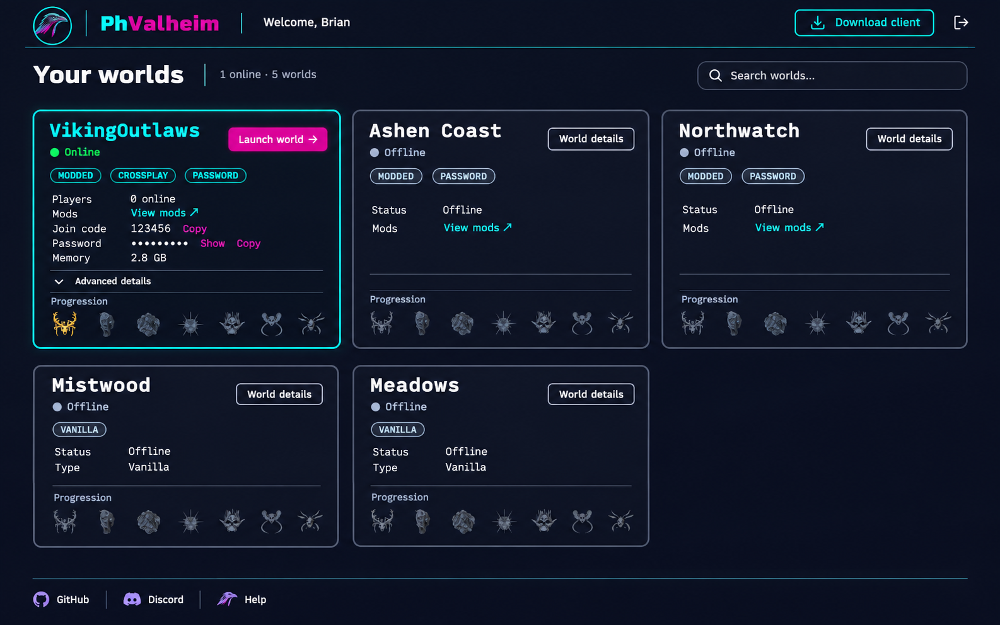](../assets/ui-concepts/2.62/classic-reforged.png)

[Open full-size PNG](../assets/ui-concepts/2.62/classic-reforged.png) · [Back to comparison](#compare-the-directions)

**Review prompt:** Does this feel like the current PhValheim UI made clearer and more polished? Which details should stay on each card, and which should move into Advanced details?

<a id="01-obsidian"></a>

## 02. Obsidian

Monochrome fjord scenery beside a simple world list.

[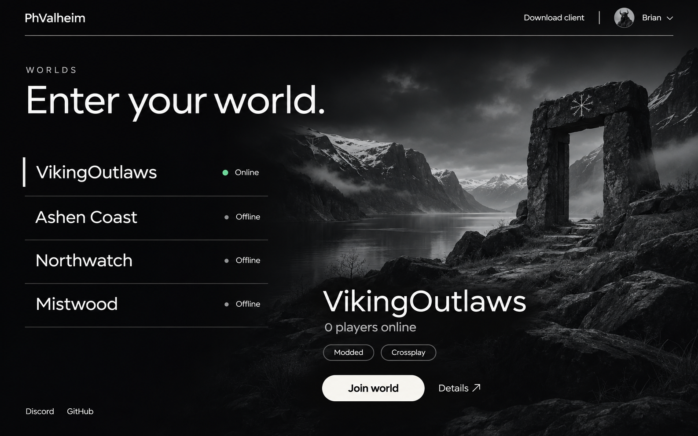](../assets/ui-concepts/2.62/01-obsidian.png)

[Open full-size PNG](../assets/ui-concepts/2.62/01-obsidian.png) · [Back to comparison](#compare-the-directions)

**Review prompt:** Can the selected world and its Join action be found immediately?

<a id="02-the-gate"></a>

## 03. The Gate

One featured world, a portal backdrop, and a world selector along the bottom.

[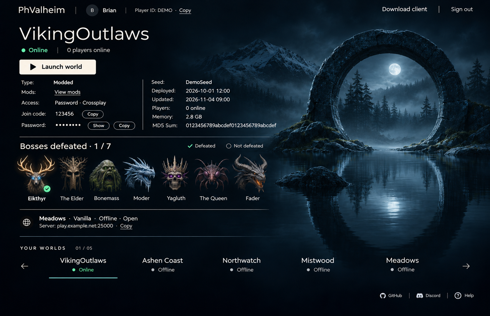](../assets/ui-concepts/2.62/02-the-gate.png)

[Open full-size PNG](../assets/ui-concepts/2.62/02-the-gate.png) · [Back to comparison](#compare-the-directions)

**Review prompt:** Does switching worlds stay obvious without competing with the main action?

<a id="03-night-atlas"></a>

## 04. Night Atlas

A compact directory and detail panel over subtle map contours.

[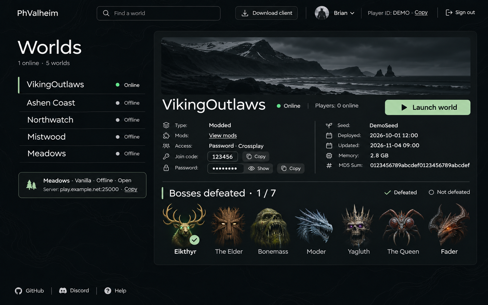](../assets/ui-concepts/2.62/03-night-atlas.png)

[Open full-size PNG](../assets/ui-concepts/2.62/03-night-atlas.png) · [Back to comparison](#compare-the-directions)

**Review prompt:** Does the panel show enough useful information without crowding the page?

<a id="04-ember"></a>

## 05. Ember

Warm ember accents, numbered navigation, and a dark longhouse scene.

[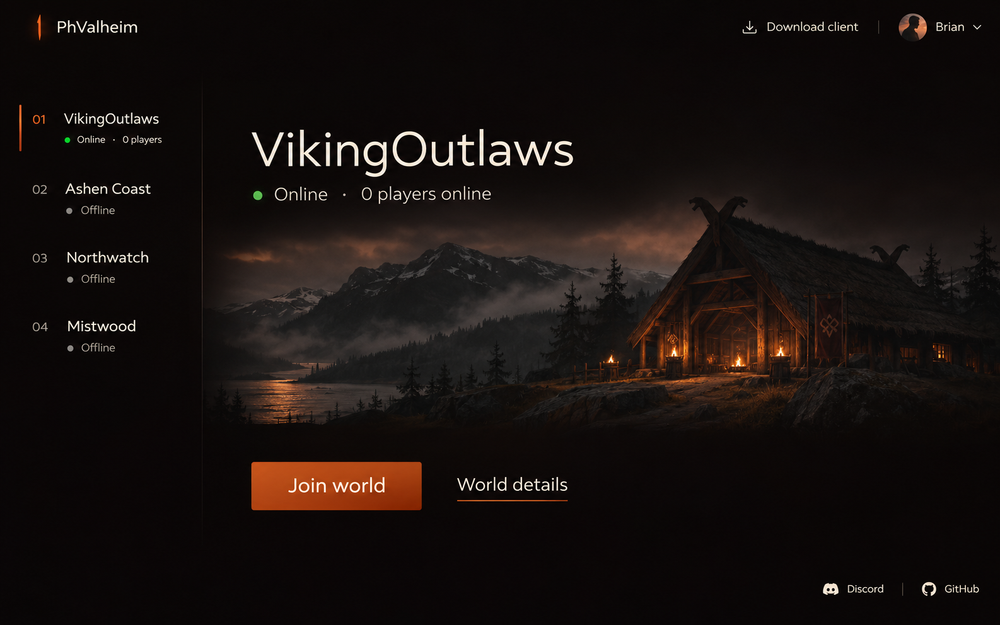](../assets/ui-concepts/2.62/04-ember.png)

[Open full-size PNG](../assets/ui-concepts/2.62/04-ember.png) · [Back to comparison](#compare-the-directions)

**Review prompt:** Do warm accents help identify selection and actions?

<a id="05-monolith"></a>

## 06. Monolith

Tall landscape posters put all four sample worlds side by side.

[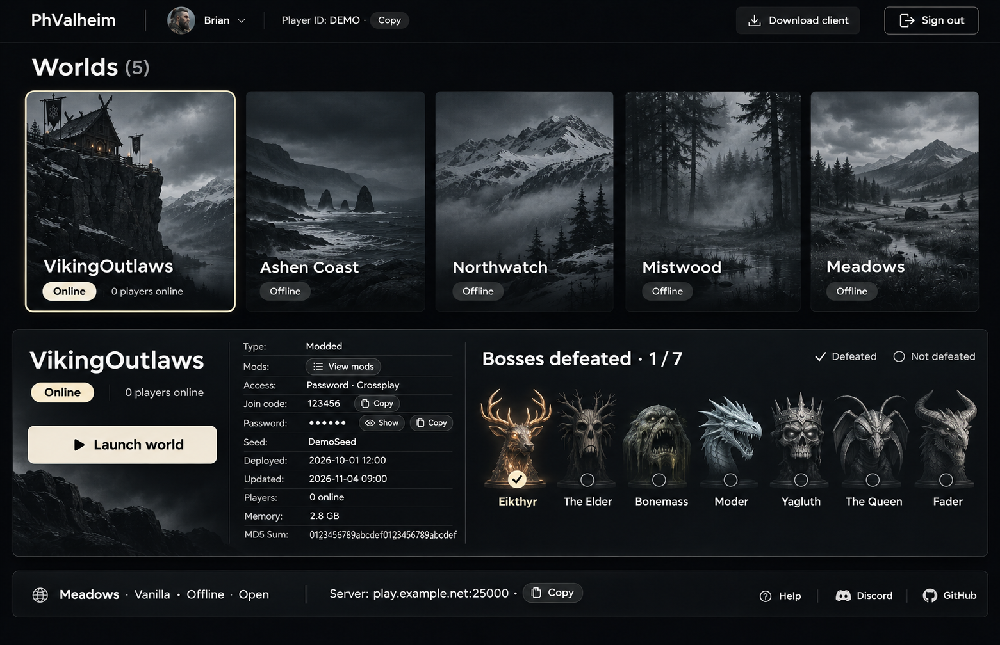](../assets/ui-concepts/2.62/05-monolith.png)

[Open full-size PNG](../assets/ui-concepts/2.62/05-monolith.png) · [Back to comparison](#compare-the-directions)

**Review prompt:** Would this remain usable with long names or many more worlds?

<a id="06-fjord"></a>

## 07. Fjord

A wide fjord scene pairs with a narrow navigation and action column.

[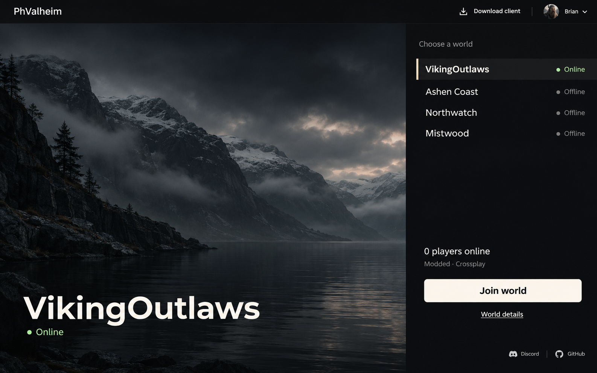](../assets/ui-concepts/2.62/06-fjord.png)

[Open full-size PNG](../assets/ui-concepts/2.62/06-fjord.png) · [Back to comparison](#compare-the-directions)

**Review prompt:** Does the split make choosing and joining a world feel connected?

<a id="07-blackglass"></a>

## 08. Blackglass

A simple table reveals selected-world details below its row.

[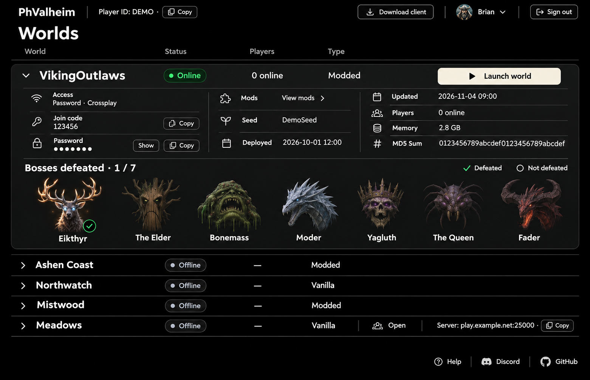](../assets/ui-concepts/2.62/07-blackglass.png)

[Open full-size PNG](../assets/ui-concepts/2.62/07-blackglass.png) · [Back to comparison](#compare-the-directions)

**Review prompt:** Is the compact layout easier to scan, and are its details worth showing upfront?

<a id="08-moonwell"></a>

## 09. Moonwell

A circular lake image and a single centered Join action minimize distractions.

[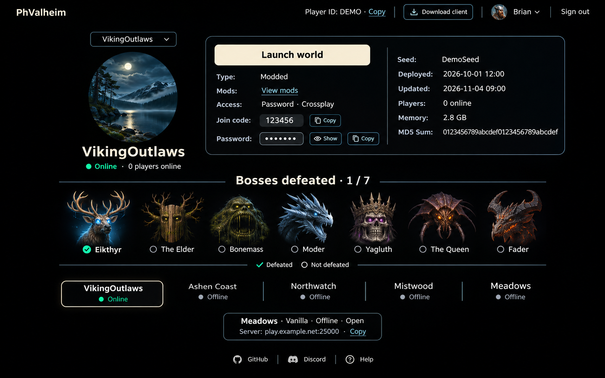](../assets/ui-concepts/2.62/08-moonwell.png)

[Open full-size PNG](../assets/ui-concepts/2.62/08-moonwell.png) · [Back to comparison](#compare-the-directions)

**Review prompt:** Are other worlds and the world picker easy enough to discover?

<a id="09-runestone"></a>

## 10. Runestone

Numbered world rows expand the selected world into a scene and action area.

[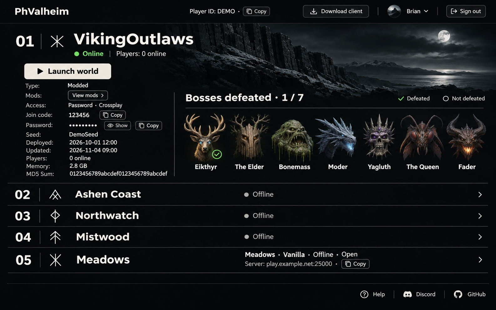](../assets/ui-concepts/2.62/09-runestone.png)

[Open full-size PNG](../assets/ui-concepts/2.62/09-runestone.png) · [Back to comparison](#compare-the-directions)

**Review prompt:** Does expansion preserve context when moving between worlds?

<a id="10-horizon"></a>

## 11. Horizon

A thin mountain panorama, one horizontal summary, and a bottom world selector.

[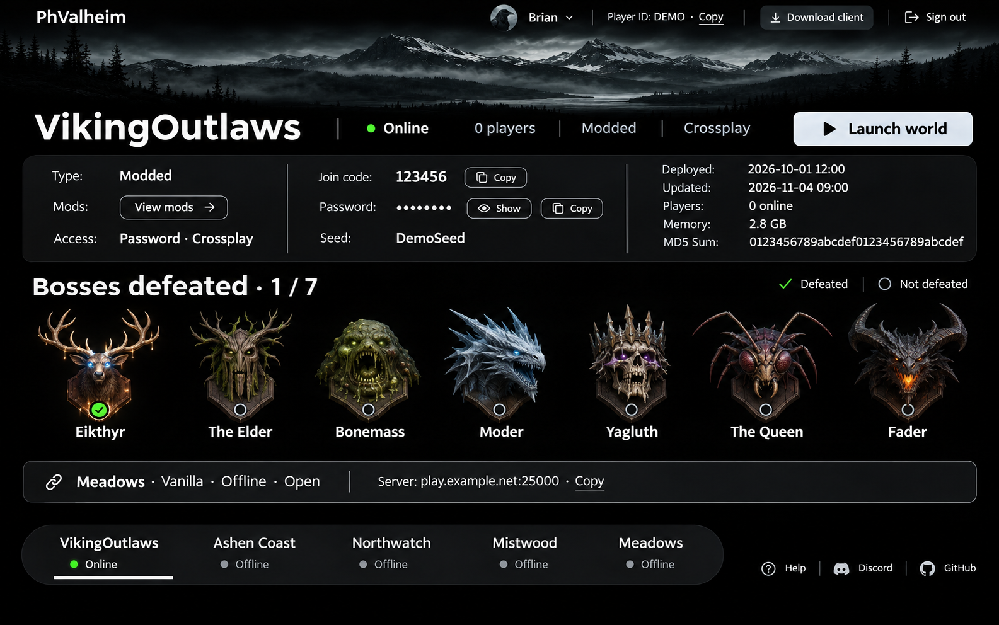](../assets/ui-concepts/2.62/10-horizon.png)

[Open full-size PNG](../assets/ui-concepts/2.62/10-horizon.png) · [Back to comparison](#compare-the-directions)

**Review prompt:** Does the horizontal layout adapt well to smaller screens?

<a id="11-afterlight"></a>

## 12. Afterlight

Moonlit forest artwork and restrained violet accents frame a simple world list.

[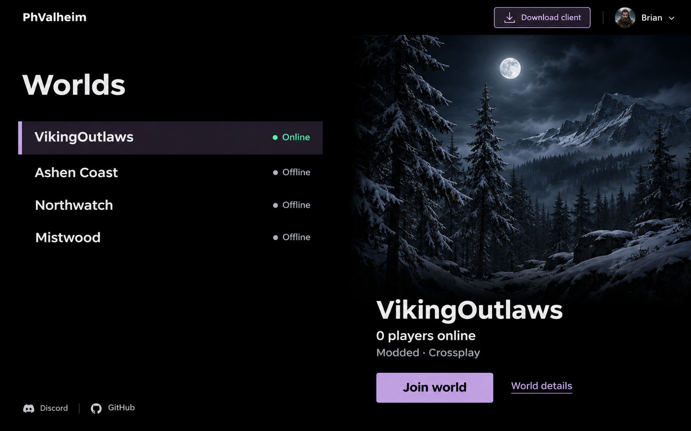](../assets/ui-concepts/2.62/11-afterlight.png)

[Open full-size PNG](../assets/ui-concepts/2.62/11-afterlight.png) · [Back to comparison](#compare-the-directions)

**Review prompt:** Does the image support the interface while keeping controls readable?

<a id="12-northstar"></a>

## 13. Northstar

A compass-style selector explores a spatial alternative, with a List toggle.

[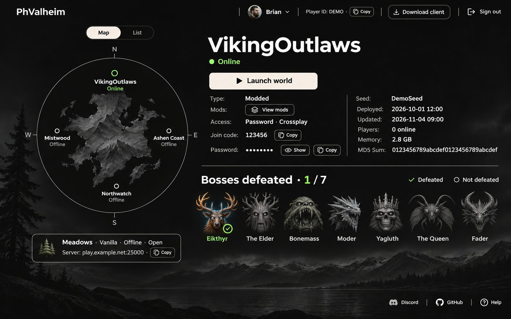](../assets/ui-concepts/2.62/12-northstar.png)

[Open full-size PNG](../assets/ui-concepts/2.62/12-northstar.png) · [Back to comparison](#compare-the-directions)

**Review prompt:** Does the map add useful orientation, and is the list alternative clear?

<a id="13-slate"></a>

## 14. Slate

A searchable world list sits beside selected-world details and a progression strip.

[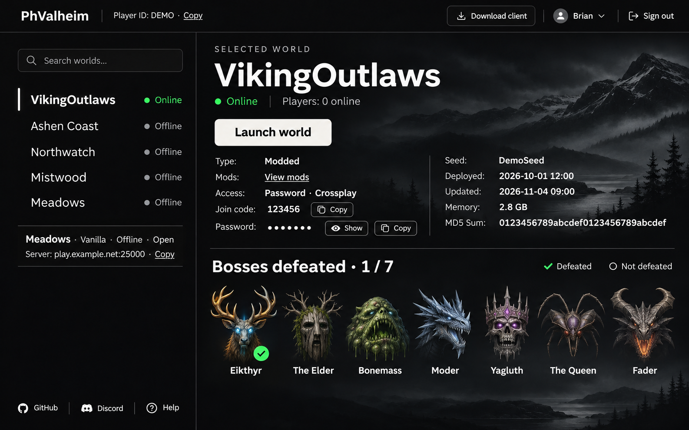](../assets/ui-concepts/2.62/13-slate.png)

[Open full-size PNG](../assets/ui-concepts/2.62/13-slate.png) · [Back to comparison](#compare-the-directions)

**Review prompt:** Does the hierarchy keep search, world selection, and joining straightforward?

## Share feedback

Discuss the concepts in the linked design review issue. Reference option numbers and names so feedback stays attached to the right rendering.

[Join the design review in issue #111](https://github.com/brianmiller/phvalheim-server/issues/111).

```text
Preferred option(s):
What works:
What feels cluttered or unclear:
Elements to combine (option numbers):
Missing information or interaction:
Mobile / keyboard / readability concerns:
```

Design decisions and implementation tracking belong in the issue. This gallery is a visual reference, not a task or completion tracker.

## About these images

Created on 4 November 2026 with OpenAI image generation for PhValheim design review. These are illustrative concept images, not screenshots of a running server; landscape art, symbols, and boss representations are not final production assets. Desktop composition is shown here; mobile layouts and accessible interactions need separate design and validation.

All fourteen PNGs are original renderings. The thirteen earlier images and their filenames remain unchanged to preserve shared links; display numbers in this gallery determine review order. [Image provenance and file inventory](../assets/ui-concepts/2.62/README.md).
