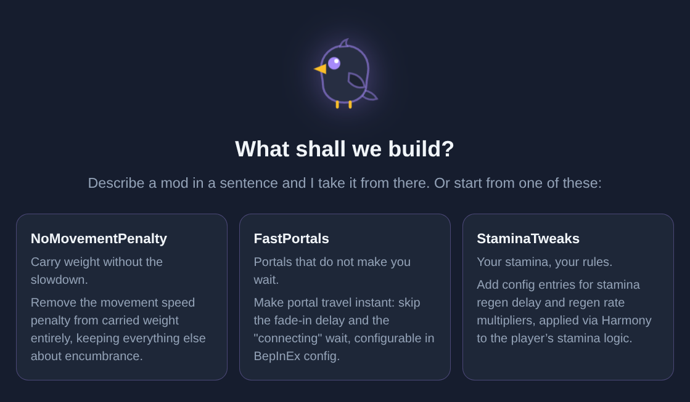

# Make your first Vibe

**An idea → a build → a package → your test world.** Hugin's Vibes is a mod workshop inside PhValheim. You describe the change, Hugin writes the C#, and you decide when to try it in a world.

[Watch the short tour](tour.md){ .md-button }

## Before you start

- Configure an AI provider under **Server Settings → AI Setup**. Choose a coding model with tool support; compatible hosted and self-hosted models work.
- Create at least one world with installed Valheim dedicated-server files.
- Open **Tools → Hugin's Vibes** and follow setup. Approve the separate Build Pak download and prepare the local game libraries when prompted.

The workbench shows disk requirements and setup progress. [What the Build Pak does →](setup.md)

## 1. Give Hugin a small, clear idea

Click **+ New Vibe**. Name the mod and describe one behavior you'd like to change.

> Make a small stamina tweak. Add a configurable stamina regeneration multiplier, default it to 1, and explain how to test it.

Choose a provider/model if needed. Keep the first request narrow so you can tell whether it works.

## 2. Follow the work

The **Vibe** conversation shows Hugin's response. **Forge** shows tool calls and results. Use **Code** to inspect files and **Build** to read compiler diagnostics.

If a build fails, ask Hugin to address the reported error. A successful build is your next checkpoint; the in-game test comes later.

Each Vibe has its own local Git repository, conversations and project notes. Write lasting decisions in **Project Notes** so Hugin can use them in later turns.

## 3. Package it

Open **Package** and click **Package**. Watch the job's status and result. When it succeeds, the download links provide the payload ZIPs.

The package contains the plugin and catalogue metadata. Game and framework reference DLLs are excluded. [Packaging and sharing →](publishing.md)

## 4. Add it to your local catalogue

Click **Publish to Catalogue**. The built version becomes available in your server's **Hugin's Vibes** catalogue, beside Thunderstore and Hexium.

You do not need a hosted repository or catalogue account for this step.

## 5. Try it in a world

1. Open a **modded test world's Mods list**.
2. Enable the **Hugin's Vibes** filter and select your mod.
3. Save the selection and **Update** that world.
4. Sync with the PhValheim client, join, and check the behavior you asked for.

Publishing never silently installs a mod into a running world. You apply it through the same mod workflow as any other package.

## Make the next version

Return to the Vibe and describe what you learned. Ask for the next change, build, package, publish, and update your test world again. Keep changes small enough to check in game.

[Bring an existing GitHub or GitLab project →](source-control.md)
